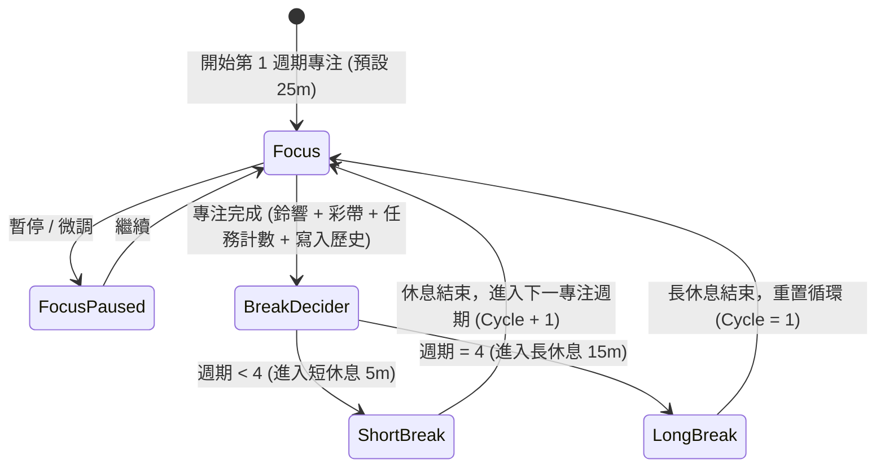
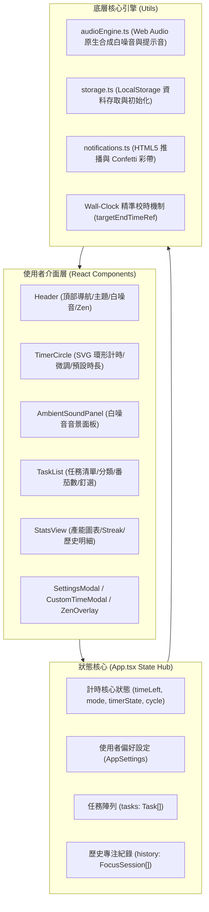

# Pomodoro Focus | 極簡質感番茄鐘

<div align="center">


<p align="center">
  <strong>專為深度工作、高效學習與時間掌控打造的現代化沉浸式番茄鐘 Web 應用程式</strong>
  <br />
  結合精準時鐘引擎、純前端原生合成白噪音、任務番茄數追蹤與數據視覺化統計
</p>

</div>

---

## 📑 目錄

1. [專案簡介](#-專案簡介)
2. [系統架構與狀態流程](#-系統架構與狀態流程)
3. [專案目錄結構](#-專案目錄結構)
4. [核心特色與功能深度解析](#-核心特色與功能深度解析)
   - [1. 經典番茄時鐘與 4 週期循環](#1-經典番茄時鐘與-4-週期循環)
   - [2. Wall-Clock 絕對時間戳精準引擎](#2-wall-clock-絕對時間戳精準引擎)
   - [3. 秒級自由時間自訂與即時微調](#3-秒級自由時間自訂與即時微調)
   - [4. Web Audio API 原生音頻合成引擎](#4-web-audio-api-原生音頻合成引擎)
   - [5. 任務規劃與番茄目標釘選](#5-任務規劃與番茄目標釘選)
   - [6. 產能統計與數據視覺化洞察](#6-產能統計與數據視覺化洞察)
   - [7. Zen 沉浸模式、分頁連動與系統推播](#7-zen-沉浸模式分頁連動與系統推播)
   - [8. 雙主題色彩體系與本地資料持久化](#8-雙主題色彩體系與本地資料持久化)
5. [底層技術實作原理揭秘](#-底層技術實作原理揭秘)
6. [鍵盤快捷鍵指南](#-鍵盤快捷鍵指南)
7. [快速上手與開發指南](#-快速上手與開發指南)
8. [番茄工作法心流指南](#-番茄工作法心流指南)
9. [瀏覽器相容性與音訊播放策略](#-瀏覽器相容性與音訊播放策略)
10. [常見問題（FAQ）](#-常見問題faq)

---

## 📖 專案簡介

**Pomodoro Focus** 融合了經典的「番茄工作法（Pomodoro Technique）」與極簡俐落的現代網頁設計美學。

市面上許多網頁計時器存在以下痛點：
- **背景分頁計時失準**：瀏覽器後台節流機制（Background Tab Throttling）導致計時器越走越慢。
- **音訊依賴外部檔案**：白噪音與鈴聲依賴外部 MP3 載入，常因網路斷線、CORS 阻礙或瀏覽器自動播放策略而失效。
- **缺乏任務與統計串連**：單純計時，無法與當前進行的待辦任務關聯，亦缺乏產能累積回饋。

**Pomodoro Focus** 為此量身打造解決方案：
- 採用 **目標時間戳（Wall-Clock Target Timestamp）** 演算法，在背景執行、視窗切換甚至休眠喚醒時依然維持毫秒級絕對精準。
- 搭載 **100% 前端 Web Audio API 聲學合成器**，所有音效與白噪音皆以演算法實時演算振盪產生，零外部資源依賴。
- 深度整合 **任務看板**、**焦點目標釘選**、**自動番茄數累積** 與 **視覺化產能趨勢統計**，打造全方位的個人生產力工作台。

---

## 🏗️ 系統架構與狀態流程

### 1. 番茄時鐘工作循環狀態機



### 2. 前端系統架構與資料流向



---

## 📁 專案目錄結構

```
pomodoro-focus-main/
├── index.html                   # HTML 進入點，配置 Google Fonts (Jakarta Sans, JetBrains Mono)
├── metadata.json                # 專案中繼資訊與應用宣告
├── package.json                 # 依賴套件定義與 npm scripts
├── tsconfig.json                # TypeScript 編譯器選項
├── vite.config.ts               # Vite 8 建置與外掛配置 (React, Tailwind CSS v4)
└── src/
    ├── main.tsx                 # React 應用程式掛載點
    ├── App.tsx                  # 應用核心入口：全域狀態調度、計時驅動、快捷鍵與版面整合
    ├── index.css                # 全域 Tailwind CSS 設定、雙主題規則與自訂捲軸樣式
    ├── types/
    │   └── index.ts             # 資料模型定義 (Task, FocusSession, AppSettings, Mode)
    ├── utils/
    │   ├── audioEngine.ts       # 核心音訊引擎：基於 Web Audio API 之合成器與白噪音產生器
    │   ├── notifications.ts     # 系統桌面推播 (Notification API) 與彩花慶祝 (Canvas Confetti)
    │   └── storage.ts           # 本地持久化封裝 (LocalStorage 讀寫、版本鍵與示範種子資料)
    └── components/
        ├── Header.tsx           # 頂部導航列：視圖切換、目前釘選任務標記、Zen 與白噪音按鈕
        ├── TimerCircle.tsx      # 主計時儀表盤：SVG 環形進度、呼吸微光、微調按鈕、時長預設
        ├── AmbientSoundPanel.tsx# 專注白噪音控制面板：音效選擇、音量調節與波形動態反饋
        ├── TaskList.tsx         # 任務管理中心：增刪查改、分類篩選、番茄目標預估與釘選連動
        ├── StatsView.tsx        # 產能洞察中心：今日時長、連續天數 (Streak)、7 天趨勢圖、歷史日誌
        ├── CustomTimeModal.tsx  # 秒級時長自訂視窗：支援 0~180 分鐘與 0~59 秒彈性設定
        ├── SettingsModal.tsx    # 全域偏好設定面板：時長、週期、自動接續、鈴聲試聽、秒針滴答
        ├── ZenOverlay.tsx       # 全螢幕 Zen 沉浸專注全螢幕視圖
        └── PomodoroGuide.tsx    # 內建番茄工作法入門手冊與心流專注技巧
```

---

## ✨ 核心特色與功能深度解析

### 1. 經典番茄時鐘與 4 週期循環

- **三大情境模式**：
  - **專注時段（Focus）**：預設 25 分鐘，溫暖沉穩的珊瑚粉橘色調，引領大腦進入無干擾的心流。
  - **短休息（Short Break）**：預設 5 分鐘，清爽鼠尾草綠，提醒起身喝水、舒緩眼部與拉筋伸展。
  - **長休息（Long Break）**：預設 15 分鐘，深邃靜謐的靛藍色調，在經歷 4 次高強度專注後提供大腦深層修復。
- **4 週期節奏指示**：計時器圓盤上方具備 4 個進度燈號，直觀標示目前所處的番茄循環階段，滿 4 週期自動提醒進入長休息。
- **SVG 動態呼吸進度環**：精心計算的 `strokeDashoffset` 圓弧軌跡，計時運作時具備平緩柔和的呼吸光暈，視覺舒適無壓迫感。

### 2. Wall-Clock 絕對時間戳精準引擎

傳統網頁計時器普遍使用 `setInterval(() => time--, 1000)`，當分頁切換至背景或電腦進入休眠時，瀏覽器出於節能考量會大幅降低計時器頻率（Throttling），導致 25 分鐘的番茄鐘在實際生活中被延誤為 30 甚至 40 分鐘。

本專案採用 **目標世界時間戳（Target Timestamp Engine）**：
- 啟動計時器時，記錄 `targetEndTime = Date.now() + timeLeft * 1000`。
- 以 200 毫秒的高頻輪詢即時校準：`remainingSeconds = Math.ceil((targetEndTime - Date.now()) / 1000)`。
- 無論切換分頁、最小化視窗、縮排至後台或電腦短暫休眠，醒來瞬間即刻重新對齊真實世界秒數，達成 **0 累積誤差**。

### 3. 秒級自由時間自訂與即時微調

- **點擊直覺編輯**：在主時鐘面板直接點選剩餘時間文字，即可呼叫出精準時間編輯面板。
- **分鐘 + 秒數精準設定**：支援 0 ~ 180 分鐘與 0 ~ 59 秒自由輸入，無論是 30 秒的深呼吸冥想，還是 90 分鐘的終極衝刺皆可完美支援。
- **即刻套用 vs 存為模式預設**：可選擇僅針對當前執行單次變更，或是寫入偏好設定成為未來該模式的預設時長。
- **時長快捷預設鈕**：主畫面下方提供 `15m`、`25m`、`45m`、`60m` 常見時長一鍵切換。
- **動態微調步進器（Nudge Buttons）**：計時器下方設有 `-5m`、`-1m`、`+1m`、`+5m`，在計時中隨時點擊即可動態延長或縮短，自動即時校準目標時間戳。

### 4. Web Audio API 原生音頻合成引擎

本專案拒絕外部音效依賴，透過原生 `AudioContext` 以數學演算法實時合成全部聲音，零載入等待、無快取限制、無流量消耗：

| 音效分類 | 音效名稱 | 合成技術細節 |
| :--- | :--- | :--- |
| **白噪音音景** | 🌧️ **細雨連綿 (Rain)** | 粉紅噪音緩衝區透過 950Hz 二階低通濾波器（BiquadFilterNode），呈現溫潤窗邊雨滴聲 |
| | 🌊 **寧靜海浪 (Waves)** | 棕噪音結合 400Hz 低通濾波，並透過 0.12Hz（約 8 秒週期）低頻振盪器（LFO）調製潮汐起伏 |
| | 🔥 **溫暖營火 (Campfire)** | 550Hz 濾波棕噪音打底，配合微型隨機脈衝震盪器模擬柴火燃燒劈啪爆破微音 |
| | 📻 **深層棕噪音 (Brown)** | 累積隨機走樣演算法產生 $1/f^2$ 能量分佈，強效遮蔽外界交談與低頻雜音 |
| | 🌸 **柔和粉紅噪音 (Pink)** | 採用 Paul Kellet 精煉濾波演算法產生 $1/f$ 頻譜，提供最均衡平緩的背景遮罩 |
| **完成提示音** | 🧘 **禪意頌缽 (Zen Bell)** | 432Hz 基礎音階疊加 864Hz、1296Hz、1728Hz 諧波，搭配 3.5 秒指數長衰減 |
| | 🪵 **溫潤木琴 (Marimba)** | C5、E5、G5、C6 琶音木琴旋律，溫暖不刺耳 |
| | 📟 **清脆電子 (Digital Beep)** | 880Hz 雙階脈衝提示音，清晰明確 |
| | 🔮 **空靈水晶 (Crystal)** | 4 頻階水晶和弦 Shimmer 疊加，通透悅耳 |
| **秒針滴答聲** | ⏰ **機械鐘 / 木魚 / 水滴** | 支援純機械秒針跳動、溫和木塊擊打、靜心水滴微響或完全靜音 |

### 5. 任務規劃與番茄目標釘選

- **任務屬性齊全**：支援設定任務名稱、六大分類（💼 工作、📚 學習、🎨 創作、📖 閱讀、🌱 生活、🧩 其他）、預估番茄鐘數（1~10 🍅）與備註。
- **目標釘選連動**：可將任一未完成任務「釘選」為當前計時器聚焦點。每次專注時段結束鈴響，系統自動為該任務增加 1 個已完成番茄數。
- **自動達成判定與彩花慶祝**：當完成番茄數達到預估值時，任務狀態會提示達成；手動勾選完成時，畫面即刻噴發彩色碎紙慶祝動畫（Canvas Confetti）。
- **即時過濾檢視**：支援「全部」、「進行中」、「已完成」標籤即時切換與批次管理。

### 6. 產能統計與數據視覺化洞察

- **四項關鍵核心產能指標**：
  - **今日專注分鐘**：今日累計有效工作時長。
  - **今日完成番茄數**：今日成功完成的專注鐘次數。
  - **連續專注天數（Streak）**：以日曆天為基準，若今天或昨天有專注紀錄即自動延續計算。
  - **歷史累計專注時數**：自使用以來的總工時沉澱。
- **近 7 天專注趨勢長條圖**：動態計算過去一週每日專注分鐘數，柱狀圖懸停即時顯示日期與時間。
- **歷史階段明細日誌**：記錄每一次完成的確切時間、時長、模式與關聯任務，並提供一鍵清空歷史功能。

### 7. Zen 沉浸模式、分頁連動與系統推播

- **Zen 全螢幕沉浸專注**：一鍵開啟純粹全螢幕介面，隱藏導航列、工作列與一切干擾，僅保留超大倒數數字與微調按鈕。支援按 <kbd>Esc</kbd> 退出。
- **分頁標題動態連動**：在瀏覽器分頁標題即時顯示當前剩餘時間與狀態（例如 `(24:59) 專注中 | 番茄鐘`），切換至其他工作視窗也能隨時掌握進度。
- **桌面推播通知**：支援 HTML5 Web Notification API，專注結束或休息結束時，即使視窗被遮擋，桌面亦會彈出系統通知。

### 8. 雙主題色彩體系與本地資料持久化

- **雙主題支援**：深度黑夜模式（Dark Mode，以純黑/石墨灰為主色調）與質感明亮模式（Light Mode），適配不同工作環境的光線需求。
- **純本地無伺服器架構**：所有偏好設定、任務清單與歷史數據皆儲存於使用者瀏覽器的 `localStorage` 中，確保 100% 隱私安全，無任何資料外流風險。

---

## 🔬 底層技術實作原理揭秘

### 1. Wall-Clock 時間校準演算法實作 (`src/App.tsx`)

```typescript
// 啟動或恢復計時時建立目標時間戳
targetEndTimeRef.current = Date.now() + timeLeft * 1000;

// 200ms 高頻輪詢校正剩餘秒數，杜絕瀏覽器後台節流造成的失準
const intervalId = window.setInterval(() => {
  if (!targetEndTimeRef.current) return;
  
  const now = Date.now();
  const remainingMs = targetEndTimeRef.current - now;
  const remainingSeconds = Math.max(0, Math.ceil(remainingMs / 1000));

  if (remainingMs <= 0) {
    clearInterval(intervalId);
    targetEndTimeRef.current = null;
    setTimeLeft(0);
    handleSessionComplete();
  } else {
    setTimeLeft(remainingSeconds);
  }
}, 200);
```

### 2. Paul Kellet 粉紅噪音演算法實作 (`src/utils/audioEngine.ts`)

粉紅噪音具備 $1/f$ 功率頻譜密度，對人耳聽覺而言各倍頻程能量分佈均衡。系統透過 7 階濾波累加實時計算：

```typescript
// Paul Kellet's method for pink noise generation
const white = Math.random() * 2 - 1;
b0 = 0.99886 * b0 + white * 0.0555179;
b1 = 0.99332 * b1 + white * 0.0750759;
b2 = 0.96900 * b2 + white * 0.1538520;
b3 = 0.86650 * b3 + white * 0.3104856;
b4 = 0.55000 * b4 + white * 0.5329522;
b5 = -0.76160 * b5 - white * 0.0168980;
output[i] = (b0 + b1 + b2 + b3 + b4 + b5 + b6 + white * 0.5362) * 0.04;
b6 = white * 0.115926;
```

### 3. LocalStorage 資料持久化綱要

系統使用版本化鍵名隔離存儲，格式嚴謹：

| 儲存鍵名 | 資料類型 | 說明 |
| :--- | :--- | :--- |
| `pomodoro_settings_v1` | `AppSettings` | 使用者設定（各模式時長、自動開始、鈴聲選擇、音量、白噪音偏好） |
| `pomodoro_tasks_v1` | `Task[]` | 待辦與完成任務清單（標題、分類、預估/完成番茄數、備註） |
| `pomodoro_history_v1` | `FocusSession[]` | 歷史完成日誌（時間戳、模式、專注分鐘數、關聯任務名稱） |

---

## ⌨️ 鍵盤快捷鍵指南

| 快捷鍵 | 動作說明 | 備註 |
| :--- | :--- | :--- |
| <kbd>Space</kbd>（空白鍵） | 開始 / 暫停計時器 | 當焦點在文字輸入框、下拉選單或彈窗時會自動停用，避免誤觸 |
| <kbd>Esc</kbd> | 關閉彈跳視窗 / 退出 Zen 沉浸模式 | 快速返回主工作儀表盤 |

---

## 🚀 快速上手與開發指南

### 1. 環境先決條件
- **Node.js**：建議版本 18.0.0 以上
- **包管理工具**：支援 `npm`、`pnpm`、`yarn` 或 `bun`

### 2. 安裝與執行

```bash
# 1. 複製專案庫 (或解壓縮原始碼至目錄)
cd pomodoro-focus-main

# 2. 安裝相依套件
npm install

# 3. 啟動本地開發伺服器 (預設在 http://localhost:3000)
npm run dev

# 4. 進行 TypeScript 類型檢查
npm run lint

# 5. 建置生產環境最佳化靜態檔案
npm run build

# 6. 本地預覽生產版本建置成果
npm run preview
```

---

## 🍅 番茄工作法心流指南

番茄工作法由 Francesco Cirillo 於 1980 年代後期創立，旨在透過規律的時間節奏擊退拖延、提升專注：

1. **選定核心任務**：在任務清單中選定並「釘選」目前最重要的單一事項，拒絕在多工之間頻繁切換。
2. **專注計時 25 分鐘**：啟動計時器與白噪音，完全沉浸於當前目標。若突發任何瑣事，隨手記錄在任務筆記中，專注時段內絕不轉移焦點。
3. **短暫放鬆 5 分鐘**：鈴響即刻停下工作，站立伸展、深呼吸或補充水分，讓大腦從執行模式切換至發散模式。
4. **每 4 週期長休息**：每完成 4 個專注番茄鐘，享受一次 15 ~ 30 分鐘的充裕長休息，徹底恢復精力與認知活力。

---

## 🌐 瀏覽器相容性與音訊播放策略

- **現代瀏覽器全面相容**：Chrome、Edge、Firefox、Safari、Opera 等最新版本皆提供原生支援。
- **音訊自動播放原則（Autoplay Policy）**：
  - 現代瀏覽器規定，網頁載入時禁止未經使用者互動自動播放音訊。
  - 本專案已實作友善的互動喚醒機制：使用者點擊介面任何按鈕（例如啟動計時器、試聽鈴聲或開啟白噪音）時，系統即自動解鎖並恢復 `AudioContext` 狀態，確保提示音準確響起。

---

## ❓ 常見問題（FAQ）

### Q1: 可以在沒有網路連線（離線環境）下使用嗎？
> **可以。** 本專案為純前端單頁應用程式（SPA），不依賴外部後端 API，所有白噪音與鈴聲音效均由瀏覽器原生 Web Audio API 即時運算產生，無須下載任何 MP3 音訊檔案，所有資料亦完整儲存於本地瀏覽器中。

### Q2: 切換到其他瀏覽器分頁或最小化視窗時，計時會失準嗎？
> **絕不延遲。** 傳統計時器使用單純的計數器容易受瀏覽器節能降頻影響，而 Pomodoro Focus 採用絕對時間戳對齊機制（`targetEndTime = Date.now() + timeLeft * 1000`），隨時根據真實世界時間精確對齊。

### Q3: 換不同電腦或開啟無痕模式，既有紀錄還會在嗎？
> 目前資料均以金鑰隔離儲存於使用者本機瀏覽器的 `localStorage` 中。更換電腦、跨瀏覽器或開啟無痕（隱私）視窗時為獨立儲存區。若日後需要備份，可手動於瀏覽器 DevTools 中匯出相關鍵值。

### Q4: 為什麼剛打開網頁時白噪音沒有聲音？
> 為符合現代瀏覽器（特別是 Chrome、Safari）的「防止自動播放干擾政策（Autoplay Policy）」，網頁必須在使用者進行第一次手動互動（點擊按鈕、切換模式等）後才能解鎖音訊上下文（AudioContext）。本系統已在第一次點擊時自動處理喚醒機制。

---

<div align="center">
  <sub>Made with ❤️ for high-performance learners and makers. Happy Focusing! 🍅</sub>
</div>
